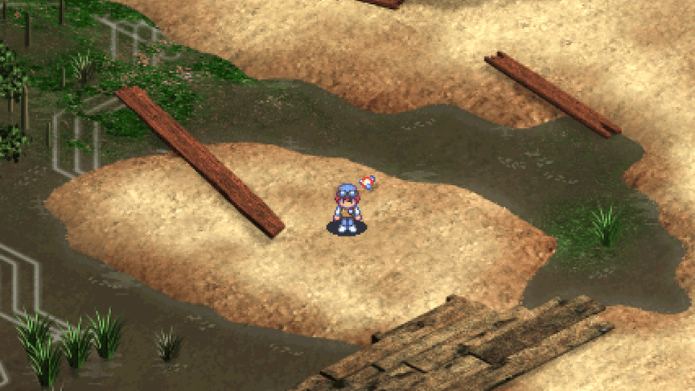
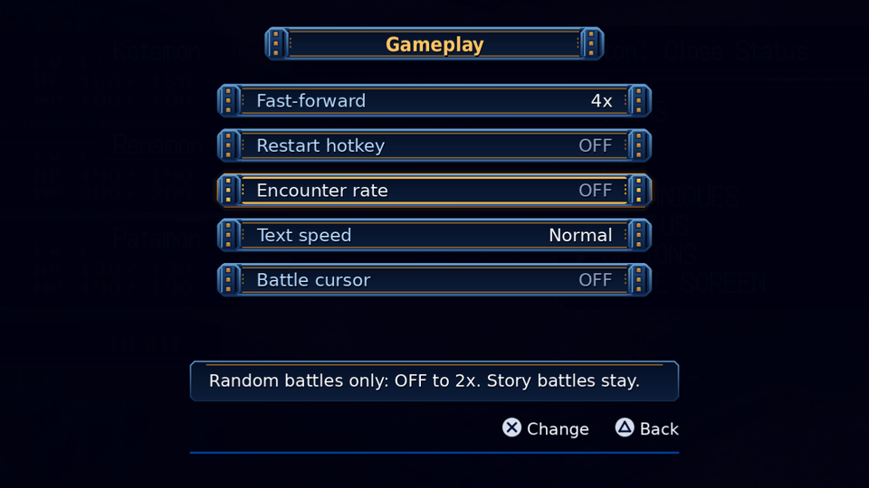
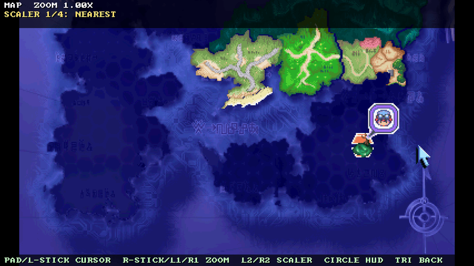

<p align="center">
  
</p>

# DW3NX

A native port of Digimon World 3 (Digimon World 2003 in Europe) to the
Nintendo Switch and to the PC, built from the matching PlayStation
decompilation. It shows as "Digimon World 3 NX" in hbmenu and Sphaira.

Latest preview: [v0.6.5-preview.48](https://github.com/Larbaco/dw3-switch/releases/tag/v0.6.5-preview.48)
([release history](docs/RELEASES.md)). New to the port? Read the
[player guide](docs/PLAYER_GUIDE.md). To try it, see
[Play it on Switch](#play-it-on-switch). All docs are listed in the
[docs index](docs/README.md). To contribute, see
[CONTRIBUTING.md](CONTRIBUTING.md).

<p align="center">
  
  
  <br>
  
  
  <br>
  
</p>
<p align="center"><sub>Captured from the PC build at 16:9 (Widescreen on).</sub></p>

## What this is

The game logic is the C code of the matching PS1 decompilation,
[ReGame-Labs/dw3_decomp](https://github.com/ReGame-Labs/dw3_decomp). Console
APIs go through [PSY-Z](https://github.com/Xeeynamo/psyz), a Psy-Q compatible
shim. A thin host supplies video, audio, input and files: SDL3 on PC, libnx
on the Switch.

```text
decomp C  ->  PSY-Z  ->  SDL3 backend (PC)
                     ->  libnx backend (Switch)
```

This is a source port, not an emulator wrapper (the `.nro` has no PS1 core),
not a static recompilation and not a remake with a new engine. You supply
your own disc; see [Legal](#legal). How the layers fit:
[ARCHITECTURE](docs/ARCHITECTURE.md), [PSYZ](docs/PSYZ.md),
[SWITCH_BACKEND](docs/SWITCH_BACKEND.md), [PATCHES](docs/PATCHES.md).

## Status

An early preview series. Expect bugs, rough visuals in some scenes and the
occasional crash. Many features are checked on PC and in the Ryubing emulator
but not yet on a Switch OLED; each release's notes say which. Report problems
on the [issue tracker](https://github.com/Larbaco/dw3-switch/issues)
([REPORTING_ISSUES](docs/REPORTING_ISSUES.md)).

- PC: the game plays from title to field and battle on your own US or EU disc.
- Switch: the title, field, battle, movies, audio and saves work on an OLED
  (US most tested; EU is earlier). The Phase 5 gate (a full run from the start
  to the first boss on hardware, US and EU) is not met yet, and the stage
  sweep on hardware is open.
- Known open items include EU audio after many techs
  ([#188](https://github.com/Larbaco/dw3-switch/issues/188)) and the opening
  movie, which runs at about 15 fps.

Work order: [ROADMAP Priority](docs/ROADMAP.md#priority). Per-item state:
[ROADMAP Status at a glance](docs/ROADMAP.md#status-at-a-glance).

## Features

What the port adds to the original game. The [player guide](docs/PLAYER_GUIDE.md)
has the controls and the details.

- **Widescreen.** About 16:9 in the field, in battle and in many menus; on by
  default, switchable in Options. Movies and the card battle stay 4:3
  ([P6.1](docs/P6.1_WIDESCREEN.md)).
- **Fast-forward.** R3 toggles 2x, 3x or 4x in the field, in battle and on the
  results screen. Under turbo the field and battle menus run at 1.5x
  ([P6.4](docs/P6.4_FAST_FORWARD.md)).
- **Options screen.** A list of groups in the title menu's style: Display,
  Sound, Gameplay and Saves (plus Cheats). It opens from the title, from the
  field menu and with Minus in battle, and is saved in `port_options.cfg`.
  Rows include Widescreen, Fast-forward, Music and SFX volume, Encounter rate,
  Text speed, Battle cursor, Restart hotkey and Auto-save
  ([PORT_OPTIONS](docs/PORT_OPTIONS.md)).
- **Auto-save.** Off by default. When on, it writes its own `autosave.bin` on
  each new field area, never over your slots; the title then shows Continue
  next to Load Game ([P6.31](docs/P6.31_AUTOSAVE.md)).
- **Per-user saves.** Saves follow the Switch user profile chosen in the
  forwarder or the system selector ([PER_USER_SAVES](docs/PER_USER_SAVES.md)).
- **Cross-region save import.** A region with no save of its own imports the
  other region's save once, converted, and never changes the original
  ([CROSS_REGION_SAVES](docs/CROSS_REGION_SAVES.md)).
- **One `.nro` for US and EU.** `dw3-switch-both.nro` holds both game copies and
  picks the region at boot, with a boot picker when both discs are present
  (P6.24, new in preview.48; not yet checked on an OLED; the separate US and EU
  `.nro` files keep shipping): [SINGLE_BUILD](docs/SINGLE_BUILD.md).
- **Full-screen map view and a first mod loader.** Y on the Map screen opens a
  zoomable, pannable map with the game's balloon, cursor and name box
  ([P6.32](docs/P6.32_MAP_ZOOM.md)). Packs you generate from your own disc can
  replace the map with an upscaled one (folder `sdmc:/switch/dw3/mods/`,
  `map_mod=0` turns it off); no pack ships with the port
  ([MOD_MAP_UPSCALE](docs/MOD_MAP_UPSCALE.md)).
- **Cheats screen.** A test aid, off behind a master switch: money, warp, give
  item and more ([PORT_OPTIONS](docs/PORT_OPTIONS.md#cheats-p620)).
- **Quit, restart and return to title.** Quit game on the title menu returns
  to hbmenu or the forwarder; the field menu can return to the title; an
  opt-in chord restarts the game without leaving the `.nro`
  ([P6.9](docs/P6.9_RESTART.md)).
- **Equipment partner cycle.** ZL / ZR change the partner on the Equipment
  screen ([P6.33](docs/P6.33_ITEMS_MENU.md)).
- **Bug fixes.** For example the Underground Path canal water and the battle
  HUD form name ([P7.7](docs/P7.7_BUG_FIXES.md)).
- **Logs and crash reports.** `dw3.log` keeps the last five runs
  (`dw3.1.log` to `dw3.4.log`); a crash writes `crash_report.txt` and the next
  launch shows a notice ([NXLINK_DEBUG](docs/NXLINK_DEBUG.md),
  [P5.4_CRASH](docs/P5.4_CRASH.md)).

Planned work (button remapping, a technical help screen, a menu-flow redesign,
language packs, texture packs and more) is in the
[ROADMAP](docs/ROADMAP.md).

## Play it on Switch

You need a Switch running Atmosphère with hbmenu, and your own disc dumped as
a Mode2 BIN/CUE pair: Digimon World 3 (USA, SLUS-01436) or Digimon World 2003
(Europe, SLES-03936). No game data ships with the port.

1. Download a `.nro` from the
   [latest release](https://github.com/Larbaco/dw3-switch/releases/latest) and
   copy it to `sdmc:/switch/`:
   - `dw3-switch-both.nro`: US and EU in one file (new in preview.48; the region
     is chosen at boot), or
   - `dw3-switch.nro` (US) or `dw3-switch-eu.nro` (EU): one region each.
2. Copy your disc's BIN and CUE files:
   - separate builds: US into `sdmc:/switch/dw3/`, EU into `sdmc:/switch/dw3/eu/`
     (a disc in `sdmc:/switch/dw3/` is found by both separate builds);
   - combined build: into `sdmc:/switch/dw3/us/` or `sdmc:/switch/dw3/eu/`. It
     does not look in `sdmc:/switch/dw3/` itself. With both regions present it
     shows a picker at boot; with one it starts that region.
3. Launch from hbmenu. The first boot extracts the game data from the disc and
   shows a progress bar. Leave it running.

```text
sdmc:/switch/dw3-switch.nro                 (or dw3-switch-both.nro)
sdmc:/switch/dw3/Digimon World 3.cue        your disc, BIN/CUE (separate builds;
sdmc:/switch/dw3/Digimon World 3.bin        the combined build wants it in us/ or eu/)
sdmc:/switch/dw3/us/                        created on first boot (eu/ for EU)
sdmc:/switch/dw3/saves/<uid>/<us|eu>/memcard/   saves, per Switch profile
sdmc:/switch/dw3/dw3.log                    logs; send them with a bug report
```

A forwarder (for example Sphaira) is the recommended way to launch it, and the
way to pick the Switch user. The port does not overclock. Back up `saves/`
before deleting a region folder. Details, controls and troubleshooting:
[PLAYER_GUIDE](docs/PLAYER_GUIDE.md). Release history and builds to avoid:
[RELEASES](docs/RELEASES.md).

## Build the PC version

You need your own US or EU disc. No disc is needed to run the tests.

```bash
git clone https://github.com/Larbaco/dw3-switch.git
cd dw3-switch
git submodule update --init vendor/dw3_decomp vendor/psyz
git -C vendor/psyz submodule update --init nugget external/SDL

# pack your own disc into runtime/us (layout: docs/DISC_SETUP.md)
python3 tools/pack_runtime.py --version us --disks disks/us --out runtime/us

cmake -S platforms/pc -B build/pc -G Ninja -DPSYZ_RENDERER=sdl3_gpu
cmake --build build/pc -j"$(nproc)"
./build/pc/dw3-pc
```

Do not initialize nugget recursively
([CI_SUBMODULES](docs/CI_SUBMODULES.md)). `-DDW3_VERSION=eu` builds EU and
`-DDW3_VERSION=both` builds one binary with both regions
([platforms/pc/README.md](platforms/pc/README.md)). Switch build
(`tools/build_switch_game.sh`, needs devkitPro), crash symbolization and
replay tests: [CONTRIBUTING.md](CONTRIBUTING.md),
[platforms/switch/README.md](platforms/switch/README.md),
[P6.15_REPLAY_TESTS](docs/P6.15_REPLAY_TESTS.md).

## Controls

Switch face buttons follow the PS1 positions: B is Cross and confirms, A is
Circle. Press Plus at the title to show the menu. R3 toggles fast-forward;
Minus opens Options at the title and in battle. The full table, the PC keys
and the port hotkeys are in [HOTKEYS](docs/HOTKEYS.md) and the
[player guide](docs/PLAYER_GUIDE.md#controls-and-hotkeys).

## Documentation

| Doc | Contents |
|---|---|
| [PLAYER_GUIDE](docs/PLAYER_GUIDE.md) | Setup, controls, menus, saves and crash reports for players. |
| [Docs index](docs/README.md) | One line per doc in `docs/`. |
| [ROADMAP](docs/ROADMAP.md) | Priority, status and phases. |
| [RELEASES](docs/RELEASES.md) | Preview index, builds to avoid. |
| [CONTRIBUTING](CONTRIBUTING.md) and [AGENTS.md](AGENTS.md) | Rules, build and test commands for contributors and AI agents. |
| [REPORTING_ISSUES](docs/REPORTING_ISSUES.md) | How to report a bug. Never attach disc images or game files. |

## Credits

This port stands on other people's work.

| Project | Thanks for |
|---|---|
| [ReGame-Labs/dw3_decomp](https://github.com/ReGame-Labs/dw3_decomp) | The matching Digimon World 3 / 2003 decompilation, the game logic this port builds on (`vendor/dw3_decomp`). |
| [Xeeynamo/psyz](https://github.com/Xeeynamo/psyz) | PSY-Z, the Psy-Q compatible shim (`vendor/psyz`). PC uses its SDL3 backends; Switch uses the libnx backend in `platforms/switch/psyz_backend/`. Pin: [PSYZ](docs/PSYZ.md). |
| [libsdl-org/SDL](https://github.com/libsdl-org/SDL) | SDL3, used through PSY-Z's desktop backends. |
| [devkitPro](https://devkitpro.org/) and [libnx](https://github.com/switchbrew/libnx) | The Switch homebrew toolchain and APIs. |
| [Xive080/D-W-3-Recomp](https://github.com/Xive080/D-W-3-Recomp) (OpenWorld2003) | A public PC recomp of the same game; a reference for CD and filesystem pitfalls and for launcher and mod catalog shape. Not a dependency. |
| [markisha64/ddw3](https://github.com/markisha64/ddw3) | Parallel Digimon World 2003 decomp (Rust/asm); reference for Digimon profiles, TIM/map tooling and language tables. |
| [dorijantomic/dw2003-play-code](https://github.com/dorijantomic/dw2003-play-code) | Browser recreation built from ddw3; a research oracle for battle formulas, the SPU and the save-block size. |
| [rsigristc/dw2003-qol-patch](https://github.com/rsigristc/dw2003-qol-patch) (**Harmony**, with Flawe, guiomatos, markisha64, EmeraldPhoenix and others) | The EU-only (SLES-03936) quality-of-life patch suite, tracked for native reimplementation: [COMMUNITY_QOL](docs/COMMUNITY_QOL.md). |

## Legal

Use a legally obtained copy of Digimon World 3 (USA, SLUS-01436) or Digimon
World 2003 (Europe, SLES-03936). This repository and its releases contain no
game data: never commit disc images, BIOS files or extracted trees (`disks/`,
`runtime/` and disc-image extensions are gitignored). The screenshots above are
the one owner-approved exception ([AGENTS.md](AGENTS.md)).

*Digimon* and *Digimon World* are trademarks of their respective owners.
This is an unofficial fan project, not affiliated with Bandai Namco or
Nintendo.

Port scaffolding and original glue code are under the [MIT License](LICENSE).
Game code under `vendor/dw3_decomp` remains under that project's license.
Original game assets belong to their owners and are not redistributed here.
