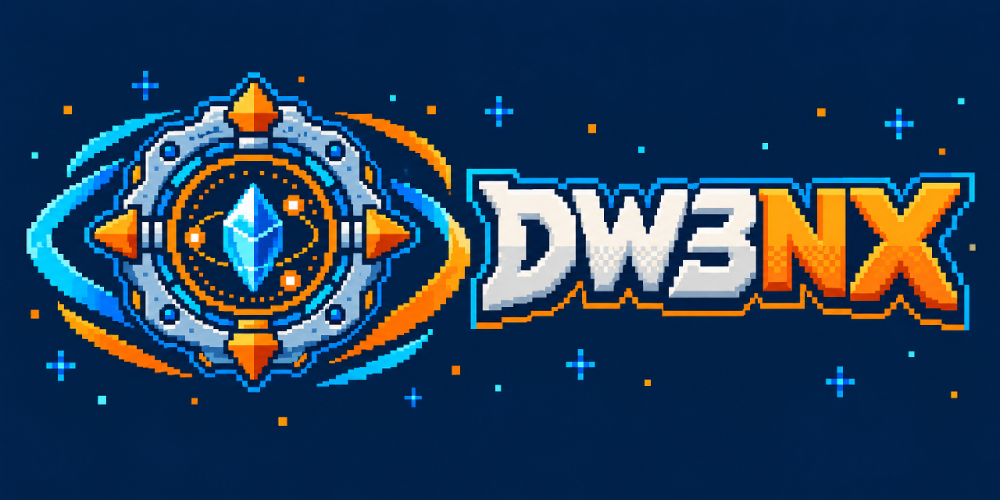
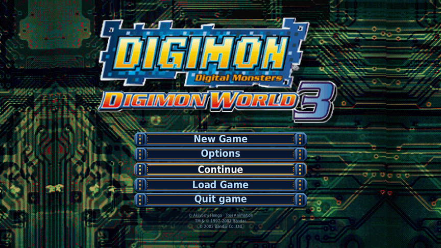
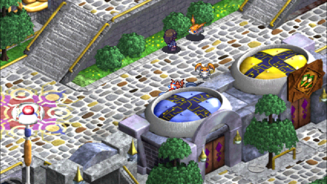
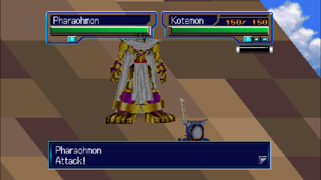
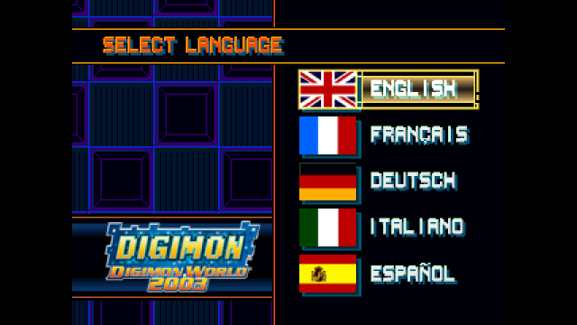

<p align="center">
  
</p>

# DW3NX

A native Nintendo Switch port of Digimon World 3 (Digimon World 2003 in
Europe), built from the matching PlayStation decompilation.

Latest preview: [v0.6.5-preview.30](https://github.com/Larbaco/dw3-switch/releases/tag/v0.6.5-preview.30).
To try it, see [Play it on Switch](#play-it-on-switch).

<p align="center">
  
  
  <br>
  
  
</p>
<p align="center"><sub>Captured from the Switch build in Ryubing and from the PC build.</sub></p>

## What this is

The game logic is the C code from the matching PS1 decompilation,
[ReGame-Labs/dw3_decomp](https://github.com/ReGame-Labs/dw3_decomp). Console
APIs go through [PSY-Z](https://github.com/Xeeynamo/psyz), a Psy-Q compatible
shim. A thin host supplies video, audio, input and files: SDL3 on PC, libnx
on the Switch.

This is a source port, not a static recompilation: the game is compiled
from the matching decomp's C, with PSY-Z standing in for the Psy-Q
libraries.

```text
decomp C  ->  PSY-Z  ->  SDL3 backend (PC)
                     ->  libnx backend (Switch)
```

This is not:

- An emulator wrapper. The `.nro` contains no PS1 core.
- A remake with a new engine.
- A place to get ROMs, disc images or BIOS files. You supply your own disc.

## How it works

- The decomp C is built natively for x86-64 and AArch64, after an audit of
  pointer and size assumptions: [P3.1_64BIT_AUDIT](docs/P3.1_64BIT_AUDIT.md).
- PSY-Z provides the Psy-Q API. On Switch it has a libnx backend that
  presents through GLES: [SWITCH_BACKEND](docs/SWITCH_BACKEND.md),
  [PSYZ](docs/PSYZ.md).
- Changes to the decomp are a patch series applied to a build copy; the
  submodule stays clean: [PATCHES](docs/PATCHES.md).
- On first boot the console extracts its runtime files from your own BIN,
  then reads plain files from the SD card:
  [STATIC_SD_LOAD](docs/STATIC_SD_LOAD.md),
  [RUNTIME_LAYOUT](docs/RUNTIME_LAYOUT.md).
- PC came first. A harness compares PC captures against DuckStation:
  [P3.9_REFERENCE](docs/P3.9_REFERENCE.md).

## Status

This is an early preview series. Expect bugs, rough visuals in some scenes
and the occasional crash. Report problems on the
[issue tracker](https://github.com/Larbaco/dw3-switch/issues).

| Area | State on Switch | Notes |
|---|---|---|
| Title and menus | Works | New Game / Options / Load Game drawn at native resolution. |
| Field | Works | Software rendering. A crash on 16:9 field maps was reported on EU; the fix (patch 0057) has shipped since preview.27 and is not yet confirmed on hardware. |
| Battle | Works | GPU textured rendering by default. The owner reports the sky stage fixed and battle above 60 fps on US and EU; the per-mode frame-time benchmark was not run. A battle crash from the preview.26 reports is still open in the roadmap. |
| Movies | Plays | The opening runs at about 15 fps with XA audio. Image quality and the full movie are not validated. |
| Audio | Works | Music loops (#209, confirmed on the OLED). The win jingle, menu sounds and battle blips play since #215 (not yet heard on hardware). A silent field map after a battle was reported once and not reproduced (P4.3). Underrun behavior has not been measured. |
| Saves | Works | Flat `save0.bin` and `save1.bin`. Save → HOME/X → relaunch → Continue was confirmed on US and EU discs (#171). Sleep/focus-loss flush and the time-delta clamp are wired (preview.29) but not yet confirmed on hardware (P10.2). |
| Rumble | Implemented, not verified on hardware | PS1 vibration requests go to HD rumble on handheld Joy-Con and player 1 (#183); on by default, `DW3_NX_RUMBLE=0` turns it off. The retail game never requests vibration, so normal play has nothing to feel yet. Left stick and D-pad work. |
| EU version | Early | Language select and own-disc extraction work. Save reload after HOME and relaunch is confirmed; a full playthrough is not yet confirmed. |
| PC host | Works | Needs your own US disc packed to `runtime/us`. |

Phases, gates and open items are in [docs/ROADMAP.md](docs/ROADMAP.md).

## Features

Things this port adds to the original game.

### Available now

- **Widescreen.** About 16:9 in field and battle, on by default, switchable
  in Port options. Title and movies stay 4:3:
  [P6.1_WIDESCREEN](docs/P6.1_WIDESCREEN.md).
- **Fast-forward.** R3 toggles 2x, 3x or 4x in field and battle:
  [P6.4_FAST_FORWARD](docs/P6.4_FAST_FORWARD.md).
- **Music and SFX volume.** Two rows in Port options, 0 to 10, 10 is the
  original mix; saved with the other options. The Options screen plays the
  game's own menu sounds, so a volume change is heard. Stepping and saving were
  seen in an EU OLED log; not yet confirmed by ear or on US:
  [P6.17_VOLUME](docs/P6.17_VOLUME.md).
- **Pacing options.** Encounter rate (off, 0.5x, 1x, 1.5x or 2x for random
  battles; story battles are never touched) and Text speed (Normal, Fast,
  Instant), both default to the original game and are saved with the other
  options. Partly seen in an EU OLED log (US is open; the "103 frame" lines of
  that log were the area name banner, not text, and are not logged as pages
  any more; real scrolled lines got a hold in patch 0068, not yet rechecked on
  the OLED): [P6.18_PACING](docs/P6.18_PACING.md).
- **Port options screen.** Opens from the title and holds the toggles below.
  Settings are saved in `port_options.cfg` next to the runtime data and are
  kept across launches (checked on PC and in an emulator; the relaunch step
  is not yet checked on the console):
  [PORT_OPTIONS](docs/PORT_OPTIONS.md#persistence).
- **Native title menu.** New Game / Options / Load Game at native
  resolution, with EU labels in the current game language.
- **Restart hotkey.** Optional, off by default. Returns to the title after
  flushing saves, without leaving the `.nro`:
  [P6.9_RESTART](docs/P6.9_RESTART.md).
- **Battle fixes.** The battle HUD shows the name of the form the partner
  fights as, and Picking / Snapping Claw steal on the killing blow. Always on;
  not yet seen on the OLED: [P7.7_BUG_FIXES](docs/P7.7_BUG_FIXES.md).
- **Battle menu memory (Battle cursor).** A row in Port options: OFF, Command
  (the command menu opens on the last command picked) or Command+Tech (and the
  technique list opens on the technique used last). Off by default, saved as
  `battle_menu_memory` in `port_options.cfg` like the other rows; the Options
  screen now has eight rows. Checked on the PC build and in Ryubing, not yet on
  the OLED: [P7.9_BATTLE_MENU_MEMORY](docs/P7.9_BATTLE_MENU_MEMORY.md).
- **EU version.** The original language-select screen at boot, and its own
  runtime: [P3_EU_BUILD](docs/P3_EU_BUILD.md).
- **Own-disc extraction on the console.** First boot builds the runtime from
  your BIN/CUE with a progress bar: [STATIC_SD_LOAD](docs/STATIC_SD_LOAD.md).
- **Flat saves.** One file per card slot, flushed at safe points. Old `.mcr`
  files convert once: [P5.3_FLAT_SAVE](docs/P5.3_FLAT_SAVE.md).
- **Battle render modes (Switch).** Minus + ZL + ZR cycles software and GPU
  rendering: [HOTKEYS](docs/HOTKEYS.md).
- **Diagnostics (Switch).** The `-nxlink` build streams logs and shows a
  debug HUD, and crashes write a report to the SD card:
  [NXLINK_DEBUG](docs/NXLINK_DEBUG.md), [P5.4_CRASH](docs/P5.4_CRASH.md).
- **Title background in widescreen (PC).** The US title fills the side
  margins: [PC_TITLE_WIDESCREEN](docs/PC_TITLE_WIDESCREEN.md).

### Planned

These are goals, not promises. The full list is in
[docs/ROADMAP.md](docs/ROADMAP.md).

- GPU rendering for the field and menus.
- Rumble tuning (an intensity setting, in-game events), other controller
  layouts, and Switch lifecycle checks (HOME, sleep, docking):
  [SWITCH_FEATURES](docs/SWITCH_FEATURES.md).
- Community quality-of-life features from the EU patch suite, reimplemented
  natively: [COMMUNITY_QOL](docs/COMMUNITY_QOL.md).
- Language packs, with Brazilian Portuguese first.
- Texture pack support: [TEXTURE_PACKS](docs/TEXTURE_PACKS.md), and later a
  modding API (mod folder, asset and data-table overrides, P8.5).
- A cheats sub-screen in Port options, to speed up testing (P6.20; first slice built, off by default, removable with `--no-cheats`).
- A player guide, a docs index and contributor docs (P6.23).
- One build for both discs: a single `.nro` (and PC binary) that finds the US
  or EU disc at boot, instead of two builds (P6.24,
  [SINGLE_BUILD](docs/SINGLE_BUILD.md)).
- A separate tool to convert saves to and from PS1 memory-card images.

## Play it on Switch

You need:

- A Switch running Atmosphère with hbmenu.
- Your own disc, dumped as a Mode2 BIN/CUE pair.
- The matching build: the US disc (SLUS-01436) with the US `.nro`, the EU
  disc (SLES-03936) with the EU `.nro`. A wrong-region disc is rejected.

Steps:

1. Download the `.nro` for your region from the
   [latest release](https://github.com/Larbaco/dw3-switch/releases/latest):
   `dw3-switch.nro` (US) or `dw3-switch-eu.nro` (EU).
2. Copy it to `sdmc:/switch/` on the SD card.
3. Copy your disc's BIN and CUE files into `sdmc:/switch/dw3/` for US, or
   `sdmc:/switch/dw3/eu/` for EU.
4. Launch the game from hbmenu. The first boot extracts the game data from
   the disc and shows a progress bar. Leave it running.

The SD card then looks like this (US shown; the EU build uses `eu/`):

```text
sdmc:/switch/dw3-switch.nro
sdmc:/switch/dw3/Digimon World 3.cue
sdmc:/switch/dw3/Digimon World 3.bin
sdmc:/switch/dw3/us/            created on first boot
```

Saves are `save0.bin` and `save1.bin` in the `memcard/` folder of the
region directory (for example `sdmc:/switch/dw3/us/memcard/`). Old
`memcardN.mcr` saves are converted once and kept as `.mcr.bak`. Back up
`memcard/` before deleting the region folder to force a re-extract.

Each release also has a `-nxlink` build that streams logs to a PC. It is for
development and not needed to play. The clocks are left as the console sets
them; the port does not overclock.

Release history and builds to avoid: [docs/RELEASES.md](docs/RELEASES.md).

## Controls

Switch face buttons follow the PS1 positions, not the Nintendo layout:
B is Cross and confirms, A is Circle.

| PS1 | Switch | PC keyboard |
|---|---|---|
| D-pad | D-pad or left stick | Arrow keys |
| Cross | B | X |
| Circle | A | D |
| Triangle | X | S |
| Square | Y | Z |
| Start | Plus | Enter |
| Select | Minus | Backspace |
| L1 / R1 | L / R | Q / R |
| L2 / R2 | ZL / ZR | W / E |

Port hotkeys:

- Press Start at the title, then pick **Options** to open Port options.
  Triangle (X on Switch) goes back.
- R3 (right-stick click) toggles fast-forward in field and battle. Choose
  2x, 3x, 4x or off in Port options.
- An opt-in restart chord (L + R + Plus + Minus on Switch) returns to the
  title after flushing saves. Enable it in Port options first.

All mappings, limits and diagnostic chords: [docs/HOTKEYS.md](docs/HOTKEYS.md).

## Build from source

### Clone

```bash
git clone https://github.com/Larbaco/dw3-switch.git
cd dw3-switch
git submodule update --init vendor/dw3_decomp vendor/psyz
git -C vendor/psyz submodule update --init nugget external/SDL
```

Do not initialize nugget recursively. Its `third_party/xmake-psx` is a PS1
matching toolchain that these hosts do not use, and fetching it can fail
with HTTP 429 or 503. See [docs/CI_SUBMODULES.md](docs/CI_SUBMODULES.md).

### Disc to runtime

Pack your own disc contents into the runtime tree. Layout and disc
requirements are in [docs/DISC_SETUP.md](docs/DISC_SETUP.md) and
[docs/RUNTIME_LAYOUT.md](docs/RUNTIME_LAYOUT.md).

```bash
python3 tools/pack_runtime.py --version us --disks disks/us --out runtime/us
```

Add `--force` if `runtime/us` already exists and is not empty.

### PC

```bash
cmake -S platforms/pc -B build/pc -G Ninja -DPSYZ_RENDERER=sdl3_gpu
cmake --build build/pc -j"$(nproc)"
./build/pc/dw3-pc
```

The runtime directory defaults to `runtime/us`; use `--runtime <dir>` for
another. More in [platforms/pc/README.md](platforms/pc/README.md).

### Switch

Needs devkitPro. CI builds in the `devkitpro/devkita64` image.

```bash
bash tools/build_switch_game.sh           # build/switch/dw3-switch.nro
bash tools/build_switch_game.sh --nxlink  # logging variant
bash tools/build_switch_game.sh --eu      # EU build
bash tools/build_switch_game.sh --no-cheats  # without the Cheats screen (P6.20)
```

A `crash_report.txt` from the console is symbolized with the `.elf` the
build leaves next to the `.nro`:
`python3 tools/symbolize_crash.py crash_report.txt build/switch/dw3-switch.elf`
([P5.4_CRASH](docs/P5.4_CRASH.md)). For a released `.nro`, use the `.elf`
from the release's `dw3-switch-elf.zip` (a local rebuild has another build id).

Releases are produced by the `switch-release.yml` workflow. Build notes,
nxlink usage and Docker details are in
[platforms/switch/README.md](platforms/switch/README.md) and
[tools/docker/README.md](tools/docker/README.md). The EU build is described
in [docs/P3_EU_BUILD.md](docs/P3_EU_BUILD.md).

### Tests

No disc needed.

```bash
python3 -m pytest tools/tests -q

# P6.15 pad-replay regression run (needs the owner's discs; Xvfb):
# tools/replay_tests.sh --quick   title menus, US + EU x5 languages
# tools/replay_tests.sh           + new game, field walk, load menu (US + EU)
# tools/replay_ryubing.sh         the Switch build in Ryubing
# (docs/P6.15_REPLAY_TESTS.md)
```

## Repository layout

```text
dw3-switch/
├── docs/                      # roadmap, gates, phase evidence
├── platforms/pc/              # PSY-Z + SDL3 -> dw3-pc
├── platforms/switch/          # Makefile sample + CMake game target, psyz_backend/
├── port/                      # overlays, cdfs, memcard, movies, patches
├── tools/                     # pack/extract, stage_sweep, compare_harness, ...
├── vendor/dw3_decomp/         # upstream decomp (submodule)
└── vendor/psyz/               # PSY-Z (submodule)
```

Prefer patches in `port/` and `platforms/` over edits inside the decomp
submodule, unless the fix belongs upstream.

## Documentation

| Doc | Contents |
|---|---|
| [ROADMAP](docs/ROADMAP.md) | Phases, gates and what is next. Phase-by-phase evidence lives under `docs/`. |
| [ARCHITECTURE](docs/ARCHITECTURE.md) | How the decomp, PSY-Z and the hosts fit together. |
| [HOTKEYS](docs/HOTKEYS.md) | Controls, port hotkeys and diagnostic chords. |
| [DISC_SETUP](docs/DISC_SETUP.md) and [RUNTIME_LAYOUT](docs/RUNTIME_LAYOUT.md) | From your disc to the runtime tree. |
| [PORT_OPTIONS](docs/PORT_OPTIONS.md) | The Port options screen. |
| [SWITCH_BACKEND](docs/SWITCH_BACKEND.md) | The libnx backend and its hardware evidence. |
| [PSYZ](docs/PSYZ.md) | PSY-Z pin and renderer notes. |
| [PATCHES](docs/PATCHES.md) | Policy for patching the decomp. |
| [RELEASES](docs/RELEASES.md) | Preview index, builds to avoid, hardware observations. |
| [REPORTING_ISSUES](docs/REPORTING_ISSUES.md) | How testers report bugs, with an example issue. |
| [GUIDE_HTML](docs/GUIDE_HTML.md) | Convert a locally saved guide into an offline chapter package or a single HTML file. Source text and output are not distributed here. |
| [AGENTS.md](AGENTS.md) | Rules for contributors and AI agents. |

## Contributing

Useful help, roughly in order:

- Test on a Switch and report what you see. Use the `-nxlink` build for
  logs ([NXLINK_DEBUG](docs/NXLINK_DEBUG.md)). Crashes also write
  `sdmc:/switch/dw3/crash_report.txt` ([P5.4_CRASH](docs/P5.4_CRASH.md)).
- Open pull requests. [AGENTS.md](AGENTS.md) has the repo rules.

Report bugs and ideas on the
[issue tracker](https://github.com/Larbaco/dw3-switch/issues).
[REPORTING_ISSUES](docs/REPORTING_ISSUES.md) lists what to include and shows
an example. Never attach
disc images or game files to an issue.

## Credits

This port stands on other people's work.

**Foundations**

| Project | Thanks for |
|---|---|
| [ReGame-Labs/dw3_decomp](https://github.com/ReGame-Labs/dw3_decomp) | The matching Digimon World 3 / 2003 decompilation. The game logic this port builds on (`vendor/dw3_decomp`). |
| [Xeeynamo/psyz](https://github.com/Xeeynamo/psyz) | PSY-Z, the Psy-Q compatible shim (`vendor/psyz`). PC uses its SDL3 backends; Switch uses the libnx backend in `platforms/switch/psyz_backend/`. Switch fork pin: [PSYZ](docs/PSYZ.md). |
| [libsdl-org/SDL](https://github.com/libsdl-org/SDL) | SDL3, used through PSY-Z's desktop backends. |

**Prior art and research**

| Project | Thanks for |
|---|---|
| [Xive080/D-W-3-Recomp](https://github.com/Xive080/D-W-3-Recomp) (OpenWorld2003) | A public PC recomp of the same game. A reference for CD and filesystem pitfalls, and for launcher and mod catalog shape. Not a dependency. |
| [markisha64/ddw3](https://github.com/markisha64/ddw3) | Parallel Digimon World 2003 decomp (Rust/asm). Reference for Digimon profiles, evolution labeling, TIM/map tooling and language tables. |
| [dorijantomic/dw2003-play-code](https://github.com/dorijantomic/dw2003-play-code) | Browser recreation built from ddw3 with ReGame cross-checks. A research oracle for battle formulas, GTE, the SPU exclusive track, save-block size and the field tick. |
| [rsigristc/dw2003-qol-patch](https://github.com/rsigristc/dw2003-qol-patch) (**Harmony**, with Flawe, guiomatos, markisha64, EmeraldPhoenix and others) | EU-only (SLES-03936) BPS quality-of-life suite, tracked for own-disc data and native reimplementation. See [COMMUNITY_QOL](docs/COMMUNITY_QOL.md). Binary patches do not load into the `.nro`. |

**Platform and tooling**

| Project | Thanks for |
|---|---|
| [devkitPro](https://devkitpro.org/) and [libnx](https://github.com/switchbrew/libnx) | The Switch homebrew toolchain and APIs for the `.nro` host. |
| The matching-decompilation and recomp communities | Patterns for shims, PC-first bring-up and honest progress reporting. |

## Legal

Use a legally obtained copy of Digimon World 3 (USA, SLUS-01436) or Digimon
World 2003 (Europe, SLES-03936). Never commit disc images, BIOS files or
extracted trees; `disks/`, `runtime/` and disc-image extensions are
gitignored. Releases do not ship them.

*Digimon* and *Digimon World* are trademarks of their respective owners.
This is an unofficial fan project, not affiliated with Bandai Namco or
Nintendo.

Port scaffolding and original glue code are under the [MIT License](LICENSE).
Game code under `vendor/dw3_decomp` remains under that project's license.
Original game assets belong to their owners and are not redistributed here.
